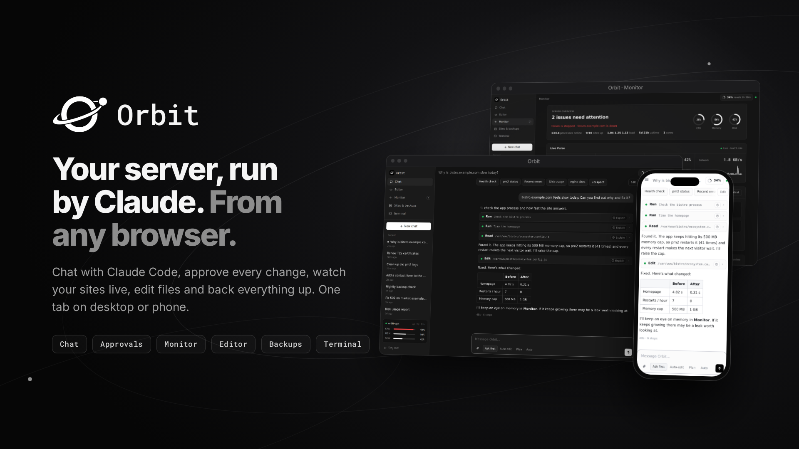
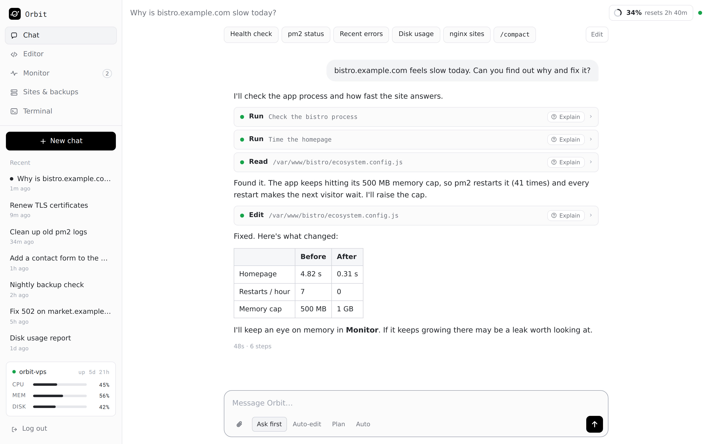
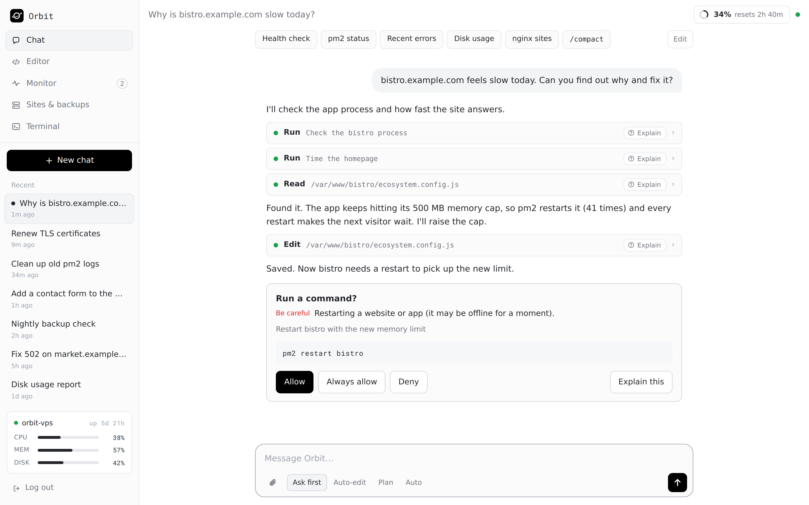
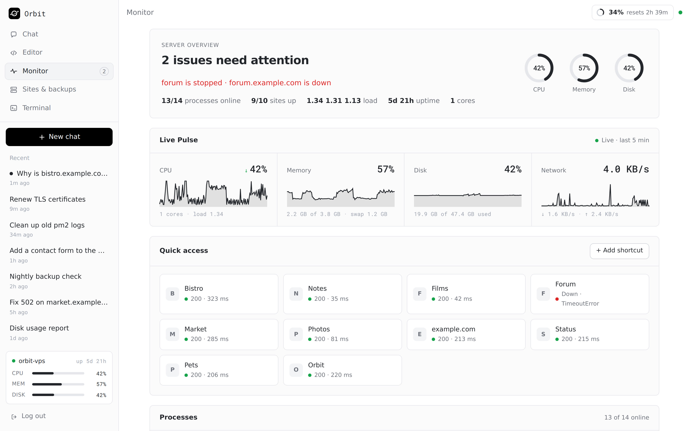
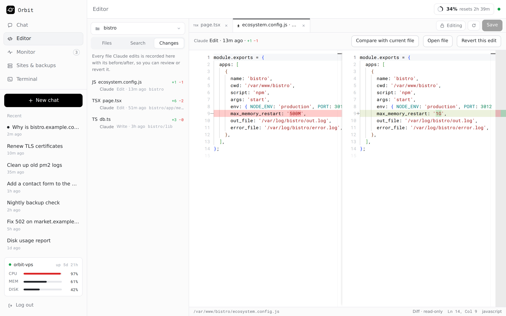
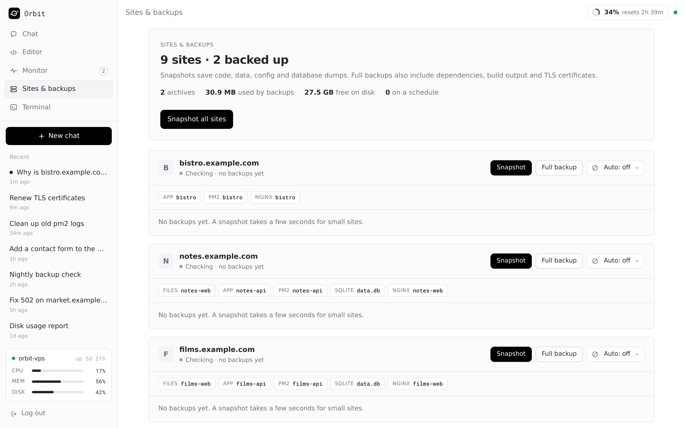
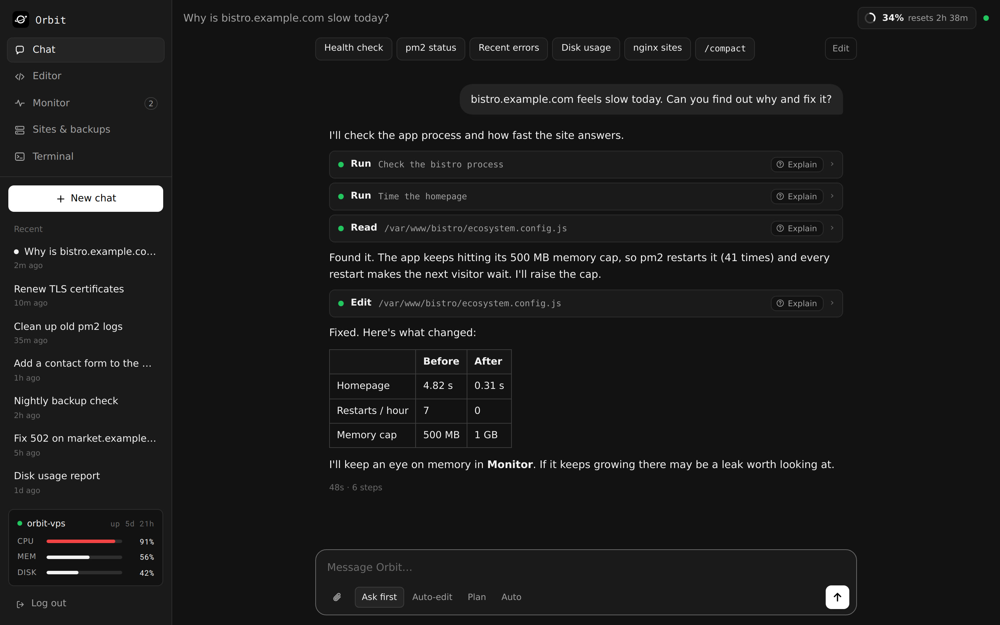
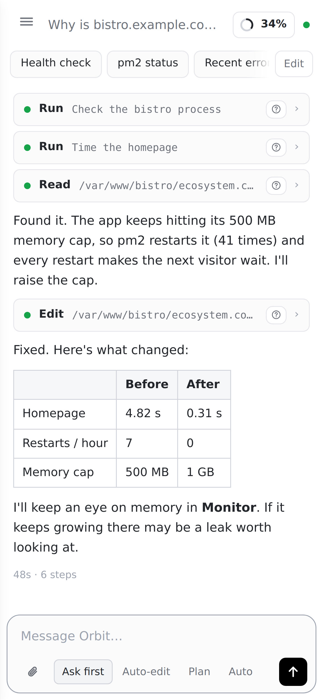

<p align="center">
  
</p>

<p align="center">
  
</p>

<h1 align="center">Orbit</h1>

<p align="center">
  A self-hosted web client for <a href="https://docs.anthropic.com/en/docs/claude-code">Claude Code</a> —
  chat with tool approvals, a live server monitor, a file editor, site backups, skills, and push notifications.
  <br>One tab, on your laptop, phone, or VPS.
</p>

<p align="center">
  
  
  
  
</p>

<p align="center">
  <a href="https://www.paypal.com/paypalme/Gtsnobiladze" target="_blank">
    
  </a>
  <a href="https://ko-fi.com/thecmdguy" target="_blank">
    
  </a>
</p>

> Orbit is a community project. It is not affiliated with or endorsed by Anthropic.

---

## Screenshots

<table>
  <tr>
    <td width="50%"><br><sub><b>Chat</b> — streamed replies, quick commands, step-by-step tool runs</sub></td>
    <td width="50%"><br><sub><b>Approvals</b> — Allow / Always allow / Deny, with plain-language Explain</sub></td>
  </tr>
  <tr>
    <td><br><sub><b>Monitor</b> — live CPU / memory / disk, pm2 processes, site checks</sub></td>
    <td><br><sub><b>Editor</b> — Monaco with a diff of every change Claude makes</sub></td>
  </tr>
  <tr>
    <td><br><sub><b>Sites &amp; backups</b> — snapshot or full backups per site</sub></td>
    <td><br><sub><b>Dark mode</b> — monochrome, color only when it means something</sub></td>
  </tr>
</table>

<p align="center">
  <br>
  <sub><b>Installable mobile app (iOS &amp; Android)</b> — add to the Home Screen, with live Web Push notifications</sub>
</p>

---

## Features

- **Chat UI over Claude Code** — one long-lived Claude session per conversation, streamed
  to the browser, with **tool-approval prompts** (Allow / Always allow / Deny), permission
  modes (Ask first / Auto-edit / Plan / Auto), and an **Auto-approve** toggle.
- **Plain-language "Explain"** — a one-click, non-technical explanation of any command or
  edit Claude is about to run.
- **Live Monitor** — CPU / memory / disk / network from `/proc`, pm2 processes, and up/down
  checks for your sites, updated in real time.
- **File editor** — Monaco-based, with a diff view of every change Claude makes and one-click revert.
- **Sites & backups** — discovers your nginx sites and takes snapshot/full backups (code, data,
  DB dumps, TLS certs).
- **Skills** — install Claude Code skills straight from GitHub.
- **Terminal** — a real pty terminal in the browser as a fallback.
- **Installable app (PWA)** — add it to your phone's Home Screen on **iOS and Android** for live Web
  Push notifications (approval needed / task finished / server alerts).
- **Monochrome, responsive design** — looks native on desktop, iOS, and Android.

## How it works (in one paragraph)

Orbit is a small set of Node services with **no build step** (plain ESM + static HTML/CSS/JS).
The main server talks to Claude through the official `@anthropic-ai/claude-agent-sdk`, launching
the Claude Code CLI already installed on your machine (so it reuses your existing login/credentials).
Five optional **side services** (usage widget, multi-model, skills, push, explain) run as separate
processes; in production an **nginx** reverse proxy puts them behind Orbit's own password login via
`auth_request`. See [`docs/ARCHITECTURE.md`](docs/ARCHITECTURE.md) for the full picture.

---

## Requirements

- **Node.js ≥ 18.17**
- **Claude Code CLI**, installed and logged in on the host — Orbit runs it for you.
  Install it and sign in once:
  ```bash
  npm install -g @anthropic-ai/claude-code   # or see Anthropic's install docs
  claude        # follow the prompt to log in (Anthropic account or API key)
  ```
  Verify `claude` works from the terminal before starting Orbit.
- **nginx** — only for the full production setup (needed to serve the side services behind the
  login and to terminate TLS). The core (chat, monitor, editor, sites, terminal) runs without it.
- **pm2** *(optional)* — a convenient process manager for production.

---

## Quick start (local)

```bash
git clone https://github.com/thecmdguy/Orbit.git
cd orbit
npm install

# create your login password (writes to ~/.orbit by default)
npm run setup            # or: node bin/orbit-setup.mjs "your password"

# start everything
npm start                # runs all six services (Ctrl-C to stop)
```

Open **http://localhost:3020/orbit/** and log in.

That gives you chat, monitor, editor, sites, and terminal immediately. The usage widget,
multi-model, skills, push, and the fast "explain" endpoint are reachable in the browser only
when nginx is routing them (see **[INSTALL.md](INSTALL.md)**) — the core experience does not
need nginx.

Configuration is optional for local use; copy `.env.example` to `.env` to change ports, paths,
the Claude working directory, or allowed origins.

## Deploy on a VPS (production)

See **[INSTALL.md](INSTALL.md)** for the full guide: domain + TLS (certbot), the nginx site,
running under pm2, allowed origins, firewalling the service ports, and updating.

---

## Security notes

- Orbit is **single-user, password-protected**. Anyone who logs in can run commands and edit
  files **as the user Orbit runs as** — treat the password like SSH access, and always serve it
  over **HTTPS** (the session cookie is `Secure`).
- Set `ORBIT_ORIGINS` to your exact public origin in production; it guards every state-changing
  request and WebSocket.
- The **Auto-approve** toggle runs *every* command and edit without asking — convenient, but only
  turn it on while you're watching.
- Bind the service ports to loopback (the defaults listen on `127.0.0.1`) and expose only nginx.
- No secrets are committed: `config.json`, `password`, `push.json`, `.env`, uploads, and backups
  all live outside the repo (see `.gitignore`).

## Project layout

```
server.mjs              main server: chat, terminal, editor, monitor, sites (port 3020)
monitor.mjs             /proc metrics, pm2, site checks (imported by server)
backups.mjs             site discovery + snapshot/full backups (imported)
fsapi.mjs               editor file API + change tracking (imported)
explain.mjs             plain-language explanations (Messages API + SDK fallback)
usage.mjs               live Claude usage widget         (side service, 3021)
models.mjs              other / local AI providers        (side service, 3022)
skills.mjs              install skills from GitHub         (side service, 3023)
push.mjs                Web Push notifications             (side service, 3024)
explain-service.mjs     explain endpoint host             (side service, 3025)
config.mjs              central configuration (reads .env / environment)
public/                 frontend (HTML/CSS/JS, PWA assets) — no build step
bin/                    setup + launcher scripts
nginx/orbit.conf.example   reverse-proxy config for production
ecosystem.config.cjs    pm2 process definitions
```

## Support

If Orbit is useful to you, you can support its development:

<p align="center">
  <a href="https://www.paypal.com/paypalme/Gtsnobiladze" target="_blank">
    
  </a>
  <a href="https://ko-fi.com/thecmdguy" target="_blank">
    
  </a>
</p>

## License

[MIT](LICENSE) © 2026 cmdguy
